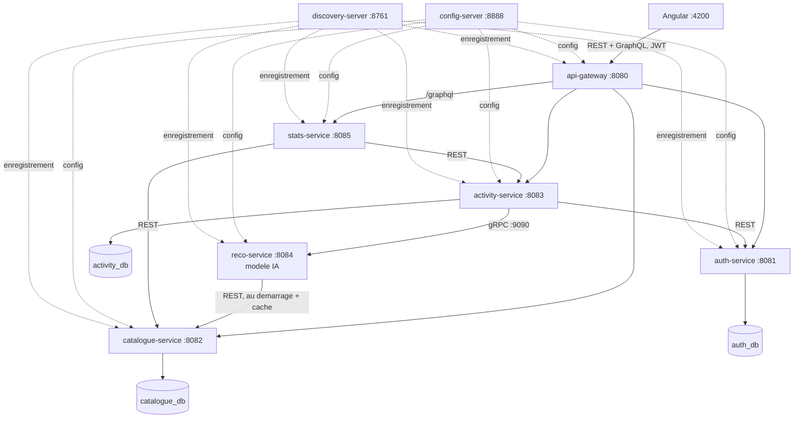

# Architecture de RecoIA



## Services

| Type | Service | Port | Role | Protocole |
|---|---|---|---|---|
| Technique | config-server | 8888 | Configuration centralisee (`config-repo/`) | HTTP |
| Technique | discovery-server | 8761 | Registre Eureka | HTTP |
| Technique | api-gateway | 8080 | Point d'entree, JWT, CORS, routage | REST |
| Metier | auth-service | 8081 | Inscription, JWT, roles, interets | REST |
| Metier | catalogue-service | 8082 | CRUD formations, images, import CSV | REST |
| Metier | activity-service | 8083 | Vues, notes, favoris, retours, orchestre les recos | REST + client gRPC |
| Metier | reco-service | 8084 / 9090 | Modele d'IA (TF-IDF, cosinus, collaboratif, retours) | gRPC |
| Metier | stats-service | 8085 | Dashboard admin | GraphQL |

## Flux "Pour toi"

1. Angular : `GET /api/recommendations` (JWT) vers la gateway.
2. La gateway valide le token et route vers `activity-service`.
3. `activity-service` recupere les interets (auth-service, REST) et l'historique (sa base).
4. Appel gRPC `Recommender.GetRecommendations` vers `reco-service` (contrat : `proto/reco.proto`).
5. `reco-service` calcule : `0.5 x contenu + 0.3 x collaboratif + 0.2 x retours`, puis renvoie la liste classee avec explications.
6. `activity-service` journalise dans `recommendation_log` et repond a Angular.

## Bases PostgreSQL (une par service)

```
auth_db      users(id, email, password_hash, role, full_name, study_level, created_at)
             user_interests(user_id, interest)
catalogue_db courses(id, title, description, category, level, skills, image_url, created_at)
activity_db  course_views(id, student_id, course_id, viewed_at)
             ratings(student_id, course_id, value, rated_at)
             favorites(student_id, course_id, added_at)
             feedbacks(student_id, course_id, verdict, created_at)
             recommendation_log(id, student_id, course_id, score, shown_at, verdict)
```
